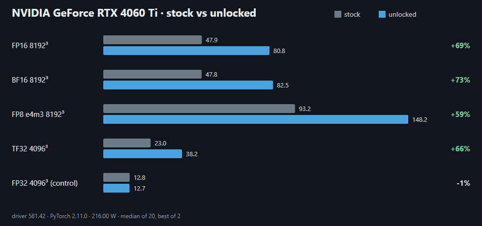

# ada-unlock-kit

A Windows helper for [nv-uefi-unlocker](https://github.com/physicsdolphin/nv-uefi-unlocker), the UEFI loader that unlocks full-rate FP16/BF16/TF32/FP8 tensor math with FP32 accumulate on RTX 40-series cards (and some RTX 30-series cards) before Windows starts.

**[Windows Unlock Tracker](https://claude.ai/artifact/4fMyfSGcTSTisYqXgPkUk5)**: every public Windows report, with gains per card and board.

The kit doesn't unlock anything itself and ships no firmware. It helps you:

| Command | What it does | Writes anything? |
|---|---|---|
| `check` | Reads your GPU, board, VBIOS, Secure Boot, BitLocker and Fast Startup state, and tells you what's known about your card from the issue trackers | No |
| `stick F:` | Copies only the files the loader opens onto a FAT32 USB stick, puts `BOOTX64.EFI` in `\EFI\BOOT\`, verifies every copy by SHA-256, writes a manifest. Starts in **replay mode**. RTX 40 only for now: it refuses when the PC has only RTX 30 cards (`--other-pc` to make a stick for another machine) | The USB stick only |
| `status` | Did this boot come from the stick? Last loader run and version, boot-order warning | No |
| `mode F: …` | Switches the stick between `replay` and `unlock`, shows `status`, `disarm`s auto-run, or turns on `reconnect-safe` for boards that hang after the unlock (`reconnect-auto` turns it off) | The USB stick only |
| `verify` | 10-second benchmark: is FP32-accumulate tensor math at full rate right now? | No |
| `bench <label>` | The matched benchmark set used in community reports | `results\` |
| `report a.json b.json` | Stock vs unlocked table, per-GHz numbers, chart PNG, fairness checks, and a tracker entry | `results\report\` |

## Requirements

- Windows 10 or 11, UEFI boot, Python 3.10+
- For `verify`, `bench`: a CUDA build of PyTorch (`pip install torch --index-url https://download.pytorch.org/whl/cu128`)
- For `stick`: the assets from upstream's `release\make-usbroot.ps1` (it downloads NVIDIA's pinned public packages and checks their hashes), and a `BOOTX64.EFI` you built or checked yourself. Recommended: the [v2.1.6 release](https://github.com/physicsdolphin/nv-uefi-unlocker/releases/tag/v2.1.6) (SHA-256 `aa0c1148…12d7`); `stick` and `status` say when the stick holds that exact binary

## Install

```powershell
git clone https://github.com/steppergg/ada-unlock-kit
cd ada-unlock-kit
pip install .
```

That gives you an `adakit` command. `verify` and `bench` also need a CUDA build of PyTorch (about 3 GB).

## Typical run

Run these from one folder: results go to `.\results`.

```powershell
adakit check
adakit bench stock                 # on a normal boot
adakit stick F: --source C:\path\to\usbroot
# power off fully, boot the stick from the firmware boot menu (replay mode)
# check F:\loader.log, then:
adakit mode F: unlock
# power off fully, boot the stick again, let Windows start
adakit status                         # confirms this boot came from the stick
adakit verify
adakit bench unlocked
adakit report results\result-stock.json results\result-unlocked.json
```

`bench` notes whether the session came from the stick and which loader version ran, so the report fills in the loader and warns if a run labelled "stock" was actually unlocked (or the other way round).

**Black screen or reset after the unlock?** If `adakit status` says the log stops inside the recursive GOP reconnect, your board deadlocks there (upstream #52, #61). With loader v2.1.6 or newer run `adakit mode F: reconnect-safe` and boot the stick again: the loader then binds only the NVIDIA GOP and leaves the console to Windows. Recovery from a hang is a full power-off.

Post `results\report\report.md` and `chart.png` to an issue. Add `entry.json` to the [Windows Unlock Tracker](https://claude.ai/artifact/4fMyfSGcTSTisYqXgPkUk5).

## Share your result

Open a [Windows unlock report](https://github.com/steppergg/ada-unlock-kit/issues/new?template=windows-report.yml) and paste the `entry.json` from `adakit report`, with `report.md`, `chart.png` and the stick's `loader.log` attached. Results that didn't work are just as useful. Reports are added to the [Windows Unlock Tracker](https://claude.ai/artifact/4fMyfSGcTSTisYqXgPkUk5) with `python tracker/build.py --add entry.json --refs ...`.

## Example output

RTX 4060 Ti 8 GB (`10de:2803`) on an ASUS ROG MAXIMUS Z790 APEX, nv-uefi-unlocker v2.1.5, 216 W limit, same driver and PyTorch in both runs ([full report](docs/example/report.md)):



| | Stock | Unlocked | Gain | Per GHz |
|---|---:|---:|---:|---:|
| FP16 8192³ | 47.86 | 80.78 | +69% | 17.1 → 33.2 |
| BF16 8192³ | 47.77 | 82.47 | +73% | 17.1 → 33.5 |
| FP8 e4m3 8192³ | 93.15 | 148.17 | +59% | 33.4 → 62.5 |
| FP32 (control) | 12.81 | 12.73 | −1% | |

Per clock the unlock is close to 2×. The absolute gain is smaller because the unlocked card runs into its power limit (about 180 W here).

## How `verify` decides

It times an FP16 GEMM with FP32 accumulate while sampling the SM clock under load, then divides by the card's full-rate peak at that clock: SMs × clock × 1024 flops (the same for Ada and Ampere, per NVIDIA's whitepapers). A stock card reads about 0.5 and an unlocked card 0.8 to 1.0 (lower end when it hits its power limit), whatever the clock. Measured on a 4060 Ti 8 GB: 0.48 stock, 0.83 unlocked at the power limit. It loads no kernel driver and needs no admin rights. For a register-level answer, upstream's `ssdiag` reads the selectors directly (it loads a signed kernel driver for the duration of the run).

## Safety

- The kit refuses any drive that isn't a FAT32 volume on a USB disk, and never formats anything.
- It checks the payload against a pinned SHA-256 and refuses a mismatch, and warns if any of the other firmware files differ from the known-good extraction of NVIDIA's 610.43.03 packages. It can't vouch for `BOOTX64.EFI`: build it from source, or compare its hash (shown by `stick` and `status`) with the release you trust.
- It starts programs by full path (System32, the NVIDIA driver folder), so a planted `nvidia-smi.exe` or `powershell.exe` in the folder you run it from is never used.
- With Secure Boot off, the stick armed and first in the boot order, the PC runs whatever loader is on that stick before Windows, with no prompt. Anyone who can plug in a different stick gets the same. Keep the stick physically safe, or leave it unarmed and pick it from the boot menu.
- New sticks start in replay mode: the payload is stored as `.off`, so the loader runs the signed firmware transaction without writing the unlock.
- The kit never creates the auto-run marker (`i_know_what_i_am_doing.txt`). `mode F: disarm` renames it if present.
- The unlock leaves some GPU firmware protections open until the next power-off. Don't use it on a shared or multi-tenant machine.
- It changes AI compute speed only. Games and DLSS don't change. For FP8 tips (BF16 output, sizes, power) see [docs/fp8.md](docs/fp8.md).

## Tests

```powershell
python -m unittest discover -s tests -t .
```

The `verify` thresholds are checked against a real RTX 4060 Ti 8 GB at a locked 2100 MHz: 35.96 TFLOPS stock (0.49) and 70.72 unlocked (0.97).
